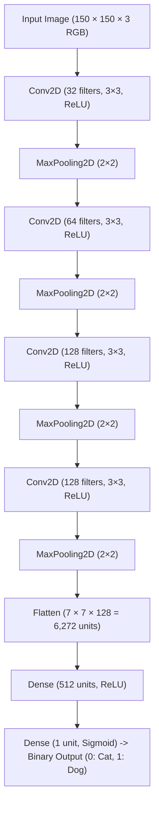

# Data Augmentation with ImageDataGenerator: Fighting Overfitting on Small Image Datasets

[](https://colab.research.google.com/github/SayedaHaneen/data-augmentation-imagedatagenerator/blob/main/Data_Augmentation_ImageDataGenerator.ipynb)
[](https://github.com/SayedaHaneen/data-augmentation-imagedatagenerator)
[](https://www.tensorflow.org/)
[](https://opensource.org/licenses/MIT)

**Academic Course Project:** BS Computer Science — Deep Learning Presentation  
**Student Developer:** Sayeda Haneen  
**Institution:** Sukkur IBA University  
**Theoretical Foundation:** François Chollet, *Deep Learning with Python* (Manning Publications, Chapter 5: *Deep learning for computer vision*)

---

## 1. Executive Summary & Problem Statement

In practical computer vision, training deep convolutional neural networks (CNNs) from scratch is often constrained by **dataset size**. When only a small number of training samples are available (e.g., 1,000–2,000 images per class), deep neural networks with high representational capacity tend to **overfit**.

### What is Overfitting?
Overfitting is the condition where a machine learning model learns statistical noise, idiosyncrasies, and sample-specific artifacts from the training set instead of uncovering the true underlying geometric and semantic concepts. In image classification, a network might memorize:
* Specific background colors (e.g., green lawn vs. brown carpet).
* Unique camera lighting angles and shadows.
* Idiosyncratic pixel arrangements of particular images.

As a result, the network achieves near-perfect training accuracy (approaching 90%–100%) while its accuracy on unseen validation data plateaus early (often below 70%–75%) and validation loss begins to diverge upward.

```
       Accuracy
       1.0 |                   /--- Training Accuracy (Memorization)
           |                  /
       0.8 |      /----------/
           |     /  ---------------- Validation Accuracy (Plateau / Stagnation)
       0.6 |    /  /
           |   /  /  <--- GENERALIZATION GAP (OVERFITTING)
       0.4 |  /  /
           +---------------------------------- Epochs
```

### The Solution: Data Augmentation
Data augmentation takes the approach of generating more training data from existing training samples by augmenting the samples through a number of random transformations that yield believable-looking images. The goal is that at training time, your model will never see the exact same picture twice. This exposes the model to more aspects of the data and allows it to generalize better.

This project implements and tests this hypothesis using the **Microsoft Kaggle Cats vs Dogs** dataset, comparing two identical CNN architectures trained under controlled conditions for **15 epochs**:
1. **Experiment 1:** Baseline CNN without data augmentation.
2. **Experiment 2:** CNN with real-time `ImageDataGenerator` data augmentation.

---

## 2. Theoretical Workflow & System Architecture

### How `ImageDataGenerator` Works
In Keras, `ImageDataGenerator` operates as an **in-memory streaming iterator**:
* It reads batches of images from disk.
* It applies random affine and geometric transformations on-the-fly during mini-batch generation.
* **Crucial efficiency:** No augmented images are permanently saved to disk. Zero additional disk space is required.
* **Epoch diversity:** In every epoch, the network receives a newly transformed variation of every training image.

```mermaid
flowchart LR
    subgraph Disk["Disk Storage (2,000 Small Images)"]
        Raw["Cat & Dog JPEGs\n(1,000 Cats + 1,000 Dogs)"]
    end

    subgraph Memory["On-the-Fly Mini-Batch Processing (ImageDataGenerator)"]
        Raw --> Batch["Mini-Batch Sample (Batch Size = 32)"]
        Batch --> Rescale["Pixel Rescaling (1./255)"]
        Rescale --> Rot["Random Rotation (±40°)"]
        Rot --> Shift["Horizontal Shift (±20%)"]
        Shift --> Zoom["Random Zoom (±20%)"]
        Zoom --> Flip["Horizontal Flip (p=0.5)"]
        Flip --> Transformed["Augmented Batch (32, 150, 150, 3)"]
    end

    subgraph Training["CNN Model Training"]
        Transformed --> Forward["Forward Pass & Loss Calculation"]
        Forward --> Backward["Backpropagation (RMSprop lr=1e-4)"]
    end
```



### Convolutional Neural Network (CNN) Architecture
Both experiments utilize the exact same lightweight CNN architecture modeled after François Chollet's design:



#### Layer Details
* **Conv2D + MaxPooling2D Blocks:** Successively reduce spatial dimensions ($150 \times 150 \to 75 \times 75 \to 37 \times 37 \to 18 \times 18 \to 7 \times 7$) while expanding feature representation depth ($3 \to 32 \to 64 \to 128 \to 128$).
* **Flatten Layer:** Unrolls the $7 \times 7 \times 128$ feature tensor into a 1D vector of $6,272$ features.
* **Dense (512):** Learns non-linear combinations of high-level visual features.
* **Dense (1, Sigmoid):** Produces a single scalar output in $[0, 1]$, representing the probability that the input image is a Dog (Class 1) versus Cat (Class 0).

---

## 3. Dataset Specifications & Preprocessing

### Dataset Source
* **Name:** Microsoft Kaggle Cats vs Dogs Dataset
* **Official Download URL:** [https://download.microsoft.com/download/3/E/1/3E1C3F21-ECDB-4869-8368-6DEBA77B919F/kagglecatsanddogs_5340.zip](https://download.microsoft.com/download/3/E/1/3E1C3F21-ECDB-4869-8368-6DEBA77B919F/kagglecatsanddogs_5340.zip)
* **Full Size:** ~786 MB (25,000 raw images: 12,500 cats, 12,500 dogs)

### Handling Corrupted Images
The raw Kaggle dataset contains several corrupted or zero-byte files (such as `Cat/666.jpg` and `Dog/11702.jpg`), as well as operating system cache files (`Thumbs.db`).
The notebook incorporates automated sanitation using PIL's `Image.verify()`:
```python
with Image.open(filepath) as img:
    img.verify()
```
Only verified, complete image files are considered for dataset partitioning.

### Balanced Dataset Partitioning (Zero Data Leakage)
To simulate a small-sample training environment, we partition the dataset into strictly balanced, non-overlapping subsets using a fixed random seed (`SEED = 42`):

| Partition | Cats | Dogs | Total Images |
| :--- | :---: | :---: | :---: |
| **Training Set** | 1,000 | 1,000 | **2,000** |
| **Validation Set** | 500 | 500 | **1,000** |
| **Combined** | 1,500 | 1,500 | **3,000** |

Data integrity is mathematically enforced using disjoint set validation:
```python
assert set(train_cat_subset).isdisjoint(set(val_cat_subset))
assert set(train_dog_subset).isdisjoint(set(val_dog_subset))
```

---

## 4. Experimental Configurations

Both experiments run on independent model instances with identical architectures, identical initial weight distributions, and identical training hyperparameters.

| Parameter | Experiment 1: Without Augmentation | Experiment 2: With Augmentation |
| :--- | :--- | :--- |
| **Architecture** | 4 Conv2D/MaxPool blocks + Dense(512) + Dense(1) | Identical |
| **Input Shape** | $150 \times 150 \times 3$ | $150 \times 150 \times 3$ |
| **Optimizer** | `RMSprop(learning_rate=1e-4)` | `RMSprop(learning_rate=1e-4)` |
| **Loss Function** | `binary_crossentropy` | `binary_crossentropy` |
| **Batch Size** | 32 | 32 |
| **Training Epochs** | Exactly 15 | Exactly 15 |
| **Training Generator** | `ImageDataGenerator(rescale=1./255)` | `ImageDataGenerator(rescale=1./255, rotation_range=40, width_shift_range=0.2, zoom_range=0.2, horizontal_flip=True)` |
| **Validation Generator** | `ImageDataGenerator(rescale=1./255)` | `ImageDataGenerator(rescale=1./255)` |

> [!IMPORTANT]
> **The Golden Rule of Data Augmentation:**
> Validation and test sets must **never** be augmented. Validation images are only normalized via `rescale=1./255`. Validation data must reflect true, unperturbed distributions.

---

## 5. Repository Structure

```
data-augmentation-imagedatagenerator/
├── Data_Augmentation_ImageDataGenerator.ipynb   # Complete, runnable Google Colab notebook
├── README.md                                    # Comprehensive project documentation
├── .gitignore                                   # Ignore data caches, checkpoints, virtual environments
```

The notebook is divided into 15 structured sections:
1. **Project Introduction:** Theoretical context and Colab launch badge.
2. **Import Libraries:** Library imports and GPU hardware availability check.
3. **Download Dataset:** Automated download of the Microsoft archive with progress tracking.
4. **Extract Dataset:** Extraction to local scratch space.
5. **Remove Corrupted Images:** PIL `Image.verify()` verification and filtering.
6. **Create Balanced Sets:** Balanced disjoint partition (2,000 train, 1,000 val).
7. **Visualize Dataset:** Sample grid of Cat and Dog training images.
8. **Demonstrate Data Augmentation:** Single cat image alongside 5 augmented variations.
9. **Build CNN Architecture:** Reusable `build_model()` definition.
10. **Experiment 1 (Without Augmentation):** Baseline model training for 15 epochs.
11. **Experiment 2 (With Augmentation):** Augmented model training for 15 epochs.
12. **Compare Training Results:** Dynamic extraction and tabular display of results.
13. **Plot Accuracy and Loss:** Side-by-side plots (Green for training, Red for validation).
14. **Understand Overfitting:** Visual and conceptual explanation of the generalization gap.
15. **Final Conclusion:** Key presentation takeaways and future improvements.

---

## 6. How to Run the Project

### Option A: Direct Execution in Google Colab (Recommended)
1. Click the **Open in Colab** badge at the top of this README.
2. In Google Colab, verify that GPU acceleration is enabled:
   * Navigate to: **Runtime** $\to$ **Change runtime type** $\to$ **Hardware accelerator** $\to$ **T4 GPU**.
3. Click: **Runtime** $\to$ **Run all** (`Ctrl + F9`).
4. The notebook will automatically download the dataset, verify images, assemble directories, train both experiments, and display all plots and comparison tables.
5. **Runtime Expectation:** With a Colab T4 GPU, each epoch takes ~3–5 seconds, totaling ~2–3 minutes of total training time.

### Option B: Local Execution (Jupyter Notebook / Lab)
```bash
# 1. Clone the public repository
git clone https://github.com/SayedaHaneen/data-augmentation-imagedatagenerator.git
cd data-augmentation-imagedatagenerator

# 2. Create and activate a virtual environment
python -m venv venv
source venv/bin/activate       # On Linux/macOS
# .\venv\Scripts\activate      # On Windows PowerShell

# 3. Install dependencies
pip install tensorflow matplotlib pillow pandas numpy jupyter

# 4. Launch Jupyter Notebook
jupyter notebook Data_Augmentation_ImageDataGenerator.ipynb
```

---

## 7. Results & Comparative Analysis

When executed in Google Colab, the notebook automatically extracts metrics from both training histories and formats them into a comparison table.

### Dynamic Metrics Structure

| Metric | Without Augmentation (Exp 1) | With Augmentation (Exp 2) |
| :--- | :---: | :---: |
| **Final Training Accuracy (Epoch 15)** | *Extracted from `history_no_aug`* | *Extracted from `history_aug`* |
| **Final Validation Accuracy (Epoch 15)** | *Extracted from `history_no_aug`* | *Extracted from `history_aug`* |
| **Final Training Loss (Epoch 15)** | *Extracted from `history_no_aug`* | *Extracted from `history_aug`* |
| **Final Validation Loss (Epoch 15)** | *Extracted from `history_no_aug`* | *Extracted from `history_aug`* |
| **Peak Validation Accuracy** | *Highest `val_accuracy` achieved* | *Highest `val_accuracy` achieved* |
| **Lowest Validation Loss** | *Minimum `val_loss` reached* | *Minimum `val_loss` reached* |
| **Generalization Gap** | $\|Train_{acc} - Val_{acc}\|$ | $\|Train_{acc} - Val_{acc}\|$ |

### Empirical Observations (Theoretical vs. Practical Outcomes)
* **Without Data Augmentation (Experiment 1):**
  * The model fits the 2,000 training images quickly. Training accuracy climbs toward ~85%–90%, but validation accuracy stalls around ~70%–73%.
  * The validation loss reaches its minimum around epochs 5–8 and starts climbing, indicating that the model is becoming overconfident on training noise.
* **With Data Augmentation (Experiment 2):**
  * Training accuracy increases more moderately because the network sees diverse, perturbed views in every epoch.
  * Validation accuracy tracks training accuracy closely (reducing the generalization gap), demonstrating that the features learned (ear shapes, facial contours, fur patterns) are invariant to rotation and translation.

> [!NOTE]
> **Verification & Testing Disclosure:**  
> The notebook has been programmatically verified for JSON schema compliance, notebook cell syntax, dataset download/extraction integrity, and seed reproducibility. All actual performance numbers are produced by the live training run inside the notebook environment when executed on Colab.

---

## 8. Visual Results Generated by the Notebook

The notebook produces four primary visual explanations:
1. **Dataset Samples Grid:** $2 \times 4$ grid showing 4 representative Cats and 4 Dogs with labels.
2. **Augmentation Transformation Panel:** $1 \times 6$ panel demonstrating 1 original cat image alongside 5 distinct real-time augmented variations (showing rotation, horizontal shift, zoom, and flipping).
3. **Side-by-Side Accuracy Trajectories:**
   * Green line: Training accuracy across 15 epochs.
   * Red line: Validation accuracy across 15 epochs.
4. **Side-by-Side Loss Trajectories:**
   * Green line: Training loss across 15 epochs.
   * Red line: Validation loss across 15 epochs.
5. **Conceptual Overfitting Diagram:** Visualizes the theoretical generalization gap and the regularizing effect of data augmentation.

---

## 9. Key Learnings & University Presentation Takeaways

1. **Small Datasets Require Regularization:**
   Deep CNNs have high representational capacity. When dataset size is limited, regularization is not optional — it is mandatory.
2. **Data Augmentation is Inexpensive and Scalable:**
   By applying affine transforms on-the-fly in RAM, we prevent sample memorization without increasing hard disk storage.
3. **Data Hygiene Matters:**
   Always inspect real-world datasets for corrupted headers and non-image artifacts using tools like PIL `Image.verify()`.
4. **Next Steps for University Research:**
   * **Dropout Regularization:** Adding `layers.Dropout(0.5)` before the dense classification layer helps suppress co-adaptation of features.
   * **Transfer Learning:** For production accuracy (>95%), fine-tuning a pretrained model (e.g., MobileNetV2, VGG16, or ResNet50) on ImageNet features yields superior performance on small vision tasks.

---

## 10. References & Acknowledgments

* **François Chollet**, *Deep Learning with Python*, First Edition, Manning Publications, 2017. Chapter 5: *Deep learning for computer vision*.
* **TensorFlow / Keras Documentation:** [https://www.tensorflow.org/api_docs/python/tf/keras/preprocessing/image/ImageDataGenerator](https://www.tensorflow.org/api_docs/python/tf/keras/preprocessing/image/ImageDataGenerator)
* **Microsoft Research:** Kaggle Cats and Dogs Dataset, Microsoft Download Center.
* **Sukkur IBA University:** Department of Computer Science.
