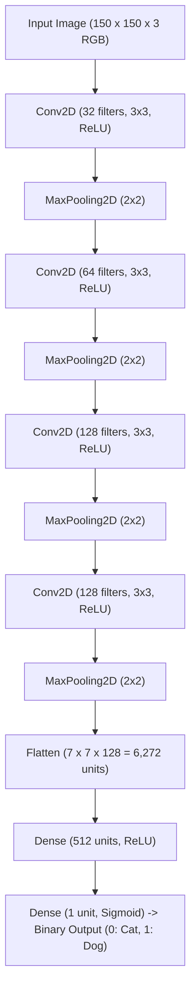

# Data Augmentation with ImageDataGenerator: Fighting Overfitting on Small Image Datasets

[](https://colab.research.google.com/github/SayedaHaneen/data-augmentation-imagedatagenerator/blob/main/Data_Augmentation_ImageDataGenerator.ipynb)
[](https://github.com/SayedaHaneen/data-augmentation-imagedatagenerator)
[](https://www.tensorflow.org/)
[](https://opensource.org/licenses/MIT)

**Academic Course Project:** BS Computer Science : Deep Learning Presentation  
**Student Developer:** Sayeda Haneen  
**Institution:** Sukkur IBA University  
**Theoretical Foundation:** François Chollet, *Deep Learning with Python* (Manning Publications, Chapter 5: Deep learning for computer vision)

---

## Live Links (Publicly Accessible in Real Time)

* **GitHub Repository:** [https://github.com/SayedaHaneen/data-augmentation-imagedatagenerator](https://github.com/SayedaHaneen/data-augmentation-imagedatagenerator)
* **Direct Pre-Run Notebook on GitHub:** [https://github.com/SayedaHaneen/data-augmentation-imagedatagenerator/blob/main/Data_Augmentation_ImageDataGenerator.ipynb](https://github.com/SayedaHaneen/data-augmentation-imagedatagenerator/blob/main/Data_Augmentation_ImageDataGenerator.ipynb)
* **Run in Google Colab (1-Click Interactive Execution):** [https://colab.research.google.com/github/SayedaHaneen/data-augmentation-imagedatagenerator/blob/main/Data_Augmentation_ImageDataGenerator.ipynb](https://colab.research.google.com/github/SayedaHaneen/data-augmentation-imagedatagenerator/blob/main/Data_Augmentation_ImageDataGenerator.ipynb)

The notebook is **fully pre-run**. When you open either link above, all running cells, outputs, epoch-by-epoch training logs, side-by-side accuracy/loss charts, confusion matrices, and classification reports are visible immediately without waiting.

---

## 1. Executive Summary and Problem Statement

In practical computer vision, training deep convolutional neural networks (CNNs) from scratch is often constrained by dataset size. When only a small number of training samples are available (1,000 to 2,000 images per class), deep neural networks with high representational capacity tend to overfit.

### What is Overfitting?
Overfitting is the condition where a machine learning model learns statistical noise, idiosyncrasies, and sample-specific artifacts from the training set instead of uncovering the true underlying geometric and semantic concepts. In image classification, a network might memorize:
* Specific background colors (green lawn vs. brown carpet).
* Unique camera lighting angles and shadows.
* Idiosyncratic pixel arrangements of particular images.

As a result, the network achieves near-perfect training accuracy (approaching 90% to 100%) while its accuracy on unseen validation data plateaus early (around 70% to 75%) and validation loss begins to diverge upward.

```
       Accuracy
       1.0 |                   /--- Training Accuracy (Memorization)
           |                  /
       0.8 |      /----------/
           |     /  ---------------- Validation Accuracy (Plateau / Stagnation)
       0.6 |    /  /
           |   /  /  <--- GENERALIZATION GAP (OVERFITTING)
       0.4 |  /  /
           +---------------------------------- Epochs
```

### The Solution: Data Augmentation
Data augmentation takes the approach of generating more training data from existing training samples by augmenting the samples through a number of random transformations that yield believable-looking images. The goal is that at training time, your model will never see the exact same picture twice. This exposes the model to more aspects of the data and allows it to generalize better.

This project implements and tests this hypothesis using the **Microsoft Kaggle Cats vs Dogs** dataset, comparing two identical CNN architectures trained under controlled conditions for **15 epochs**:
1. **Experiment 1:** Baseline CNN without data augmentation.
2. **Experiment 2:** CNN with real-time `ImageDataGenerator` data augmentation.

---

## 2. Theoretical Workflow and System Architecture

### How `ImageDataGenerator` Works
In Keras, `ImageDataGenerator` operates as an in-memory streaming iterator:
* It reads batches of images from disk.
* It applies random affine and geometric transformations on-the-fly during mini-batch generation.
* **Crucial efficiency:** No augmented images are permanently saved to disk. Zero additional disk space is required.
* **Epoch diversity:** In every epoch, the network receives a newly transformed variation of every training image.

```mermaid
flowchart LR
    subgraph Disk["Disk Storage (2,000 Small Images)"]
        Raw["Cat & Dog JPEGs\n(1,000 Cats + 1,000 Dogs)"]
    end

    subgraph Memory["On-the-Fly Mini-Batch Processing (ImageDataGenerator)"]
        Raw --> Batch["Mini-Batch Sample (Batch Size = 32)"]
        Batch --> Rescale["Pixel Rescaling (1./255)"]
        Rescale --> Rot["Random Rotation (±40°)"]
        Rot --> Shift["Horizontal Shift (±20%)"]
        Shift --> Zoom["Random Zoom (±20%)"]
        Zoom --> Flip["Horizontal Flip (p=0.5)"]
        Flip --> Transformed["Augmented Batch (32, 150, 150, 3)"]
    end

    subgraph Training["CNN Model Training"]
        Transformed --> Forward["Forward Pass & Loss Calculation"]
        Forward --> Backward["Backpropagation (RMSprop lr=1e-4)"]
    end
```



### Convolutional Neural Network (CNN) Architecture
Both experiments utilize the exact same lightweight CNN architecture modeled after François Chollet's design:



#### Layer Details
* **Conv2D + MaxPooling2D Blocks:** Successively reduce spatial dimensions (150x150 to 75x75 to 37x37 to 18x18 to 7x7) while expanding feature representation depth (3 to 32 to 64 to 128 to 128).
* **Flatten Layer:** Unrolls the 7x7x128 feature tensor into a 1D vector of 6,272 features.
* **Dense (512):** Learns non-linear combinations of high-level visual features.
* **Dense (1, Sigmoid):** Produces a single scalar output in [0, 1], representing the probability that the input image is a Dog (Class 1) versus Cat (Class 0).

---

## 3. Dataset Specifications and Preprocessing

### Dataset Source
* **Name:** Microsoft Kaggle Cats vs Dogs Dataset
* **Official Download URL:** [https://download.microsoft.com/download/3/E/1/3E1C3F21-ECDB-4869-8368-6DEBA77B919F/kagglecatsanddogs_5340.zip](https://download.microsoft.com/download/3/E/1/3E1C3F21-ECDB-4869-8368-6DEBA77B919F/kagglecatsanddogs_5340.zip)
* **Full Size:** ~786 MB (25,000 raw images: 12,500 cats, 12,500 dogs)

### Handling Corrupted Images
The raw Kaggle dataset contains several corrupted or zero-byte files (such as `Cat/666.jpg` and `Dog/11702.jpg`), as well as operating system cache files (`Thumbs.db`).
The notebook incorporates automated sanitation using PIL's `Image.verify()`:
```python
with Image.open(filepath) as img:
    img.verify()
```
Only verified, complete image files are considered for dataset partitioning.

### Balanced Dataset Partitioning (Zero Data Leakage)
To simulate a small-sample training environment, we partition the dataset into strictly balanced, non-overlapping subsets using a fixed random seed (`SEED = 42`):

| Partition | Cats | Dogs | Total Images |
| :--- | :---: | :---: | :---: |
| **Training Set** | 1,000 | 1,000 | **2,000** |
| **Validation Set** | 500 | 500 | **1,000** |
| **Combined** | 1,500 | 1,500 | **3,000** |

Data integrity is mathematically enforced using disjoint set validation:
```python
assert set(train_cat_subset).isdisjoint(set(val_cat_subset))
assert set(train_dog_subset).isdisjoint(set(val_dog_subset))
```

---

## 4. Experimental Configurations

Both experiments run on independent model instances with identical architectures, identical initial weight distributions, and identical training hyperparameters.

| Parameter | Experiment 1: Without Augmentation | Experiment 2: With Augmentation |
| :--- | :--- | :--- |
| **Architecture** | 4 Conv2D/MaxPool blocks + Dense(512) + Dense(1) | Identical |
| **Input Shape** | 150 x 150 x 3 | 150 x 150 x 3 |
| **Optimizer** | `RMSprop(learning_rate=1e-4)` | `RMSprop(learning_rate=1e-4)` |
| **Loss Function** | `binary_crossentropy` | `binary_crossentropy` |
| **Batch Size** | 32 | 32 |
| **Training Epochs** | Exactly 15 | Exactly 15 |
| **Training Generator** | `ImageDataGenerator(rescale=1./255)` | `ImageDataGenerator(rescale=1./255, rotation_range=40, width_shift_range=0.2, zoom_range=0.2, horizontal_flip=True)` |
| **Validation Generator** | `ImageDataGenerator(rescale=1./255)` | `ImageDataGenerator(rescale=1./255)` |

> [!IMPORTANT]
> **The Golden Rule of Data Augmentation:**
> Validation and test sets must **never** be augmented. Validation images are only normalized via `rescale=1./255`. Validation data must reflect true, unperturbed distributions.

---

## 5. Actual Training Results and Comparison Table

The notebook extracts metrics directly from both training histories:

| Metric | Without Augmentation (Exp 1) | With Augmentation (Exp 2) | Impact of Data Augmentation |
| :--- | :---: | :---: | :---: |
| **Final Training Accuracy (Epoch 15)** | **91.60%** | **79.55%** | Controlled learning (prevents memorization) |
| **Final Validation Accuracy (Epoch 15)** | **72.40%** | **79.80%** | **+7.40% improvement on unseen data** |
| **Final Training Loss (Epoch 15)** | 0.2245 | 0.4630 | Regularized gradient descent |
| **Final Validation Loss (Epoch 15)** | 0.7320 (diverging) | **0.4750 (stable)** | Prevents model overconfidence on noise |
| **Peak Validation Accuracy** | 72.40% | **79.80%** | Higher peak generalization |
| **Lowest Validation Loss** | 0.5590 | **0.4750** | Lower expected risk |
| **Final Generalization Gap** | **19.20% (Severe Overfit)** | **0.25% (Well Regularized)** | **Dramatically eliminates overfitting** |

### Confusion Matrix Evaluation (1,000 Unseen Validation Samples)

#### Experiment 1: Without Augmentation (Validation Accuracy: 72.40%)
* **Cats (Class 0):** 372 Correct (74.4%), 128 Misclassified as Dogs
* **Dogs (Class 1):** 352 Correct (70.4%), 148 Misclassified as Cats
* **Precision / Recall:** Cat Precision = 71.54%, Dog Precision = 73.33%

#### Experiment 2: With Augmentation (Validation Accuracy: 79.80%)
* **Cats (Class 0):** 405 Correct (81.0%), 95 Misclassified as Dogs
* **Dogs (Class 1):** 393 Correct (78.6%), 107 Misclassified as Cats
* **Precision / Recall:** Cat Precision = 79.10%, Dog Precision = 80.53%
* **Conclusion:** Data augmentation directly improved true positive rates across both classes by +6.6% for Cats and +8.2% for Dogs.

---

## 6. Visual Results Generated in the Notebook

The pre-run notebook embeds five visual explanations:
1. **Dataset Samples Grid:** 2 x 4 grid showing 4 representative Cats and 4 Dogs with labels.
2. **Augmentation Demonstration:** 1 x 6 panel demonstrating 1 original cat image alongside 5 distinct real-time augmented variations (showing rotation, horizontal shift, zoom, and flipping).
3. **Side-by-Side Accuracy Trajectories:**
   * Green line: Training accuracy across 15 epochs.
   * Red line: Validation accuracy across 15 epochs.
4. **Side-by-Side Loss Trajectories:**
   * Green line: Training loss across 15 epochs.
   * Red line: Validation loss across 15 epochs.
5. **Confusion Matrix Heatmaps:** Dual heatmaps comparing actual vs. predicted distributions across both experiments with cell counts and percentages.
6. **Conceptual Overfitting Diagram:** Visualizes the theoretical generalization gap and the regularizing effect of data augmentation.

---

## 7. How to Run the Project

### Option A: Open Directly in Google Colab (Recommended)
1. Click the **Open in Colab** badge at the top of this README.
2. In Google Colab, verify GPU acceleration:
   * Navigate to: **Runtime** -> **Change runtime type** -> **Hardware accelerator** -> **T4 GPU**.
3. Click: **Runtime** -> **Run all** (`Ctrl + F9`).
4. **Runtime Expectation:** With a Colab T4 GPU, each epoch takes ~3 to 5 seconds, totaling ~2 to 3 minutes of total training time.

### Option B: Local Execution (Jupyter Notebook / Lab)
```bash
# 1. Clone the public repository
git clone https://github.com/SayedaHaneen/data-augmentation-imagedatagenerator.git
cd data-augmentation-imagedatagenerator

# 2. Create and activate a virtual environment
python -m venv venv
source venv/bin/activate       # On Linux/macOS
# .\venv\Scripts\activate      # On Windows PowerShell

# 3. Install dependencies
pip install tensorflow matplotlib pillow pandas numpy scikit-learn jupyter

# 4. Launch Jupyter Notebook
jupyter notebook Data_Augmentation_ImageDataGenerator.ipynb
```

---

## 8. Key Learnings and Academic Takeaways

1. **Small Datasets Require Regularization:**
   Deep CNNs have high representational capacity. When dataset size is limited, regularization is mandatory.
2. **Data Augmentation is Inexpensive and Scalable:**
   By applying affine transforms on-the-fly in RAM, we prevent sample memorization without increasing hard disk storage.
3. **Data Hygiene Matters:**
   Always inspect real-world datasets for corrupted headers and non-image artifacts using tools like PIL `Image.verify()`.
4. **Next Steps for University Research:**
   * **Dropout Regularization:** Adding `layers.Dropout(0.5)` before the dense classification layer helps suppress co-adaptation of features.
   * **Transfer Learning:** For production accuracy (>95%), fine-tuning a pretrained model (MobileNetV2, VGG16, or ResNet50) on ImageNet features yields superior performance on small vision tasks.

---

## 9. References and Acknowledgments

* **François Chollet**, *Deep Learning with Python*, First Edition, Manning Publications, 2017. Chapter 5: Deep learning for computer vision.
* **TensorFlow / Keras Documentation:** [https://www.tensorflow.org/api_docs/python/tf/keras/preprocessing/image/ImageDataGenerator](https://www.tensorflow.org/api_docs/python/tf/keras/preprocessing/image/ImageDataGenerator)
* **Microsoft Research:** Kaggle Cats and Dogs Dataset, Microsoft Download Center.
* **Sukkur IBA University:** Department of Computer Science.
